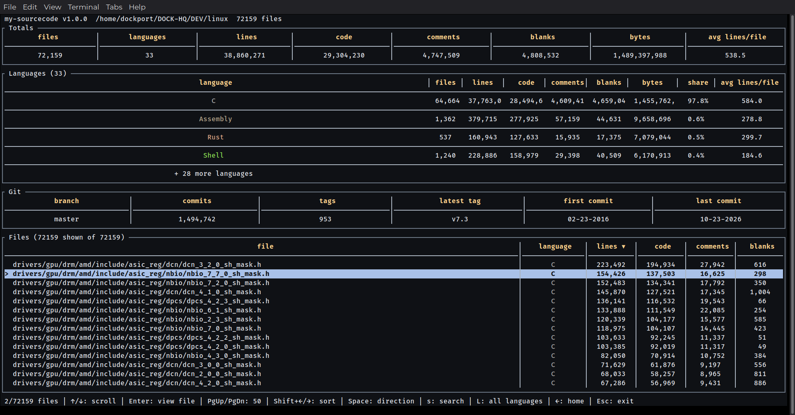
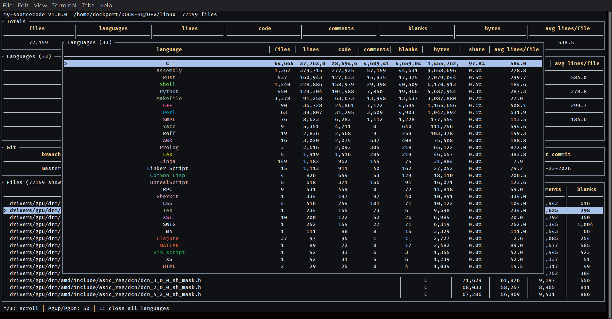
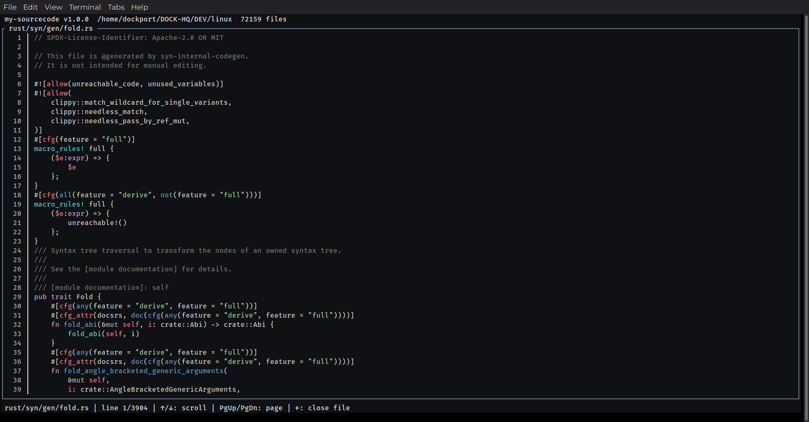

## Repo Overview

**My-Sourcecode** is a TUI binary that uses established packages to scan and analyze your repository’s source code.

## Core Features

- Shows the number of lines of code, blank lines, and comments in your project.
- Lists all files and their programming languages.
- Open indivudal files to view code. 
- Filters results to show only source-code-related files, using the same approach as GitHub’s Linguist.
- Shows a repository’s language breakdown: the percentage of code written in each programming language.
- Computes the average number of lines of code per file.

## Tech Stack

| Component | Technology |
|---|---|
| Language | Rust |
| TUI  | ratatui |
| Statistics library | tokei |
| Syntax parser | syntect |

## How to Run

- Binary releases available for Linux x86_64 systems.
- Place the binary in a directory and make it executable.
- Optionally, create a desktop entry so you can launch it with a click.
- Alternatively, run it from a terminal in several ways.

## Preview

